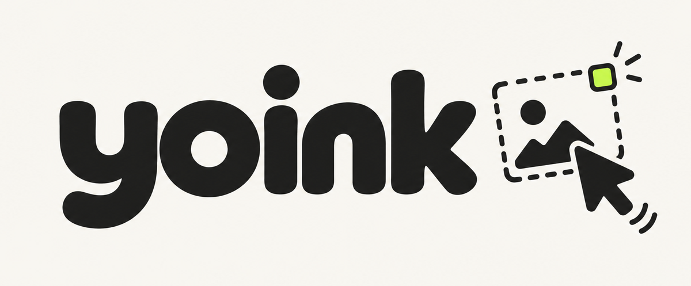

<p align="center">
  
</p>

<p align="center">
  <strong>Screenshot. Paste. Back to work.</strong><br>
  Press your hotkey, select an area, hit ⌘V.<br>
  No file hunting. No drag-and-drop gymnastics.
</p>

## Why Yoink?

macOS **⌘⇧4** saves a file. **⌃⌘⇧4** copies an image. **Yoink does both**, with a file URL on the clipboard too.

Paste images into chats and docs, or file paths into compatible terminals for coding assistants. Terminal support varies. Only need image copying? The built-in shortcut works fine.

PNGs stay in `~/Desktop/screenshots/` until you delete them. No uploads. No Dock icon. No menu bar.

## Install

Requires **macOS**, **Rust 1.85+**, and **Xcode Command Line Tools**.

```sh
git clone https://github.com/heyojules/yoink.git
cd yoink
make install HOTKEY=cmd+shift+2
```

Starts now and at login. Allow **Screen Recording** in System Settings → Privacy & Security, then run `make restart`.

## Use

**Hotkey → select → ⌘V.** That's it. A thumbnail pops at your cursor once it's copied; a red shake means it failed (`make logs`).

<kbd>Drag</kbd> region · <kbd>Space</kbd> window · <kbd>Esc</kbd> cancel

```sh
~/.local/bin/yoink  # capture once
make logs          # view errors
make restart       # restart
make uninstall     # remove tool; keep screenshots
```

<details>
<summary>Hotkeys & signing</summary>

- `make install` defaults to **⌘⇧4**. Disable the matching macOS shortcut first; restore it after uninstalling.
- Rebuilds may need Screen Recording permission again. Use `make install SIGN_ID="Your signing identity"` for stable signing.

</details>
